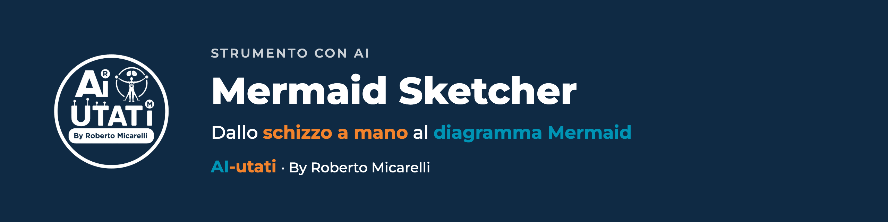

<p align="center">
  
</p>

<p align="center">
  <a href="https://mermaid-sketcher-one.vercel.app"></a>
  
  
  
</p>

**Disegni a mano libera, ottieni il codice Mermaid.** Trasformi uno schizzo, tuo o caricato come immagine, in un diagramma Mermaid pronto per [MermaidChart](https://www.mermaidchart.com/).

## In 30 secondi

| Scheda | Dettaglio |
|---|---|
| **Cos'è** | Un'app web che legge il tuo disegno e lo converte in diagramma |
| **Per chi** | Chi ragiona con carta e penna e poi deve consegnare un diagramma pulito |
| **Come provarla** | [Apri la demo](https://mermaid-sketcher-one.vercel.app) |

## Come funziona

| Passo | Cosa succede |
|---|---|
| 1. **Disegna o carica** | Canvas per il disegno a mano libera, oppure immagine in drag and drop |
| 2. **Leggi** | Il sistema analizza il disegno ed estrae il testo con l'OCR |
| 3. **Converti** | L'AI interpreta la struttura e genera il codice Mermaid |
| 4. **Copia** | Codice pulito, senza backtick né formattazione in più |

## Com'è fatta

| Menu | Disegno | Testo | Risultato |
|:---:|:---:|:---:|:---:|
|  |  |  |  |

## Avvio in locale

Serve Node.js 18 o successivo e una chiave API OpenAI.

```bash
git clone https://github.com/RobertoMicarelli/mermaid-sketcher.git
cd mermaid-sketcher
npm install
cp env.example .env.local     # poi inserisci la tua OPENAI_API_KEY
npm run dev
```

La chiave va solo in `.env.local`, mai nel codice.

## Tecnologie

| Tecnologia | Scopo |
|---|---|
| Next.js 14 + React 18 | Applicazione |
| Tailwind CSS | Stili |
| OpenAI GPT-4o | Analisi del disegno e generazione del codice |
| Tesseract.js | OCR del testo nel disegno |
| HTML5 Canvas | Disegno a mano libera |
| Mermaid.js | Anteprima dei diagrammi |

Per risolvere i problemi di OCR vedi [TESSERACT_SETUP.md](TESSERACT_SETUP.md). Le modifiche nel tempo sono in [CHANGELOG.md](CHANGELOG.md).

## Contribuire

Le proposte sono benvenute: leggi [CONTRIBUTING.md](CONTRIBUTING.md) e il [codice di condotta](CODE_OF_CONDUCT.md), poi apri una pull request.

## Licenza

[MIT](LICENSE).

---

**AI-utati** · By Roberto Micarelli · Formatore, Coach, Consulente · [ai-utati.it](https://www.ai-utati.it)

**Provalo ora:** disegna tre scatole e due frecce, e guarda che codice esce.
